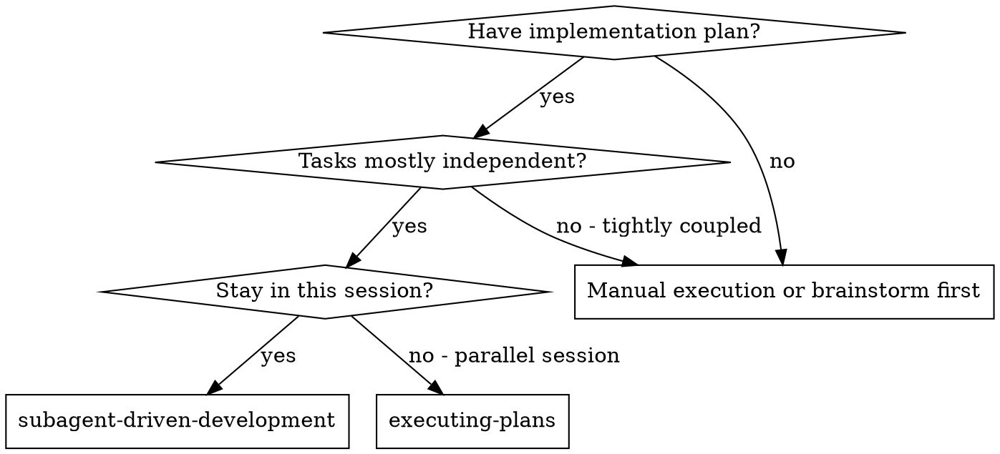
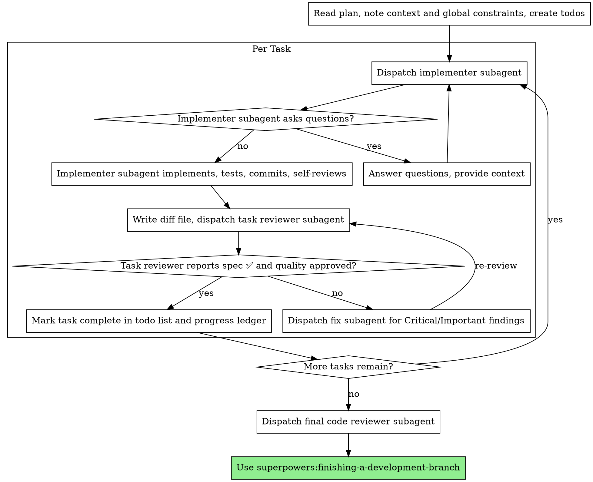

# Subagent-Driven Development

Execute plan by dispatching a fresh implementer subagent per task, a task review (spec compliance + code quality) after each, and a broad whole-branch review at the end.

**Why subagents:** You delegate tasks to specialized agents with isolated context. By precisely crafting their instructions and context, you ensure they stay focused and succeed at their task. They should never inherit your session's context or history — you construct exactly what they need. This also preserves your own context for coordination work.

**Core principle:** Fresh subagent per task + task review (spec + quality) + broad final review = high quality, fast iteration

**Narration:** between tool calls, narrate at most one short line — the ledger and the tool results carry the record.

**Continuous execution:** Do not pause to check in with your human partner between tasks. Execute all tasks from the plan without stopping. The only reasons to stop are: BLOCKED status you cannot resolve, ambiguity that genuinely prevents progress, or all tasks complete. "Should I continue?" prompts and progress summaries waste their time — they asked you to execute the plan, so execute it.

## When to Use

**vs. Executing Plans (parallel session):**
- Same session (no context switch)
- Fresh subagent per task (no context pollution)
- Review after each task (spec compliance + code quality), broad review at the end
- Faster iteration (no human-in-loop between tasks)

## The Process

## Pre-Flight Plan Review

Before dispatching Task 1, scan the plan once for conflicts:

- tasks that contradict each other or the plan's Global Constraints
- anything the plan explicitly mandates that the review rubric treats as a defect

Present everything you find to your human partner as one batched question — each finding beside the plan text that mandates it, asking which governs — before execution begins. If the scan is clean, proceed without comment.

## Model Selection

Use the least powerful model that can handle each role to conserve cost and increase speed.

**Mechanical implementation tasks** (isolated functions, clear specs, 1-2 files): use a fast, cheap model.

**Integration and judgment tasks** (multi-file coordination, pattern matching, debugging): use a standard model.

**Architecture and design tasks**: use the most capable available model.

**Review tasks**: choose the model with the same judgment, scaled to the diff's size, complexity, and risk.

**Always specify the model explicitly when dispatching a subagent.**

## Handling Implementer Status

**DONE:** Generate the review package, then dispatch the task reviewer.

**DONE_WITH_CONCERNS:** Read the concerns before proceeding. If about correctness or scope, address them before review.

**NEEDS_CONTEXT:** Provide the missing context and re-dispatch.

**BLOCKED:** Assess the blocker:
1. Context problem → provide more context
2. Needs more reasoning → re-dispatch with more capable model
3. Task too large → break into smaller pieces
4. Plan wrong → escalate to human

## Handling Reviewer ⚠️ Items

The task reviewer may report "⚠️ Cannot verify from diff" items. These do not block the rest of the review, but you must resolve each one yourself before marking the task complete.

## File Handoffs

- **Task brief:** Extract the task's full text to a uniquely named file
- **Report file:** Name after the brief, put in dispatch prompt
- **Reviewer inputs:** three paths — brief file, report file, and review package

## Durable Progress

Track progress in a ledger file, not only in todos.

- At skill start, check for a ledger
- When a task's review comes back clean, append one line to the ledger
- The ledger is your recovery map

## Prompt Templates

- implementer-prompt.md - Dispatch implementer subagent
- task-reviewer-prompt.md - Dispatch task reviewer subagent (spec compliance + code quality)